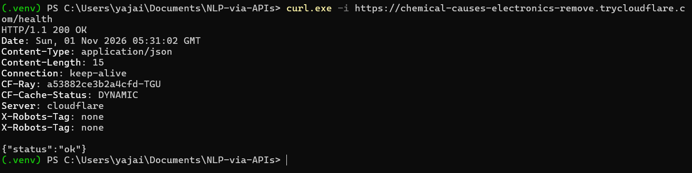
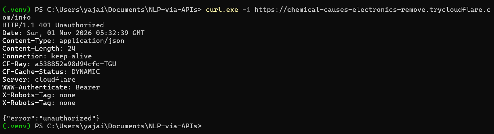
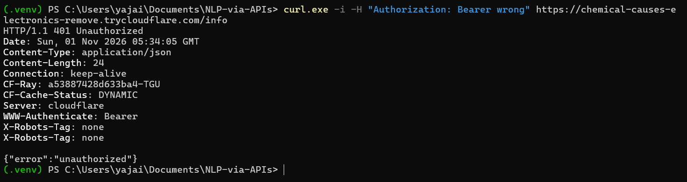
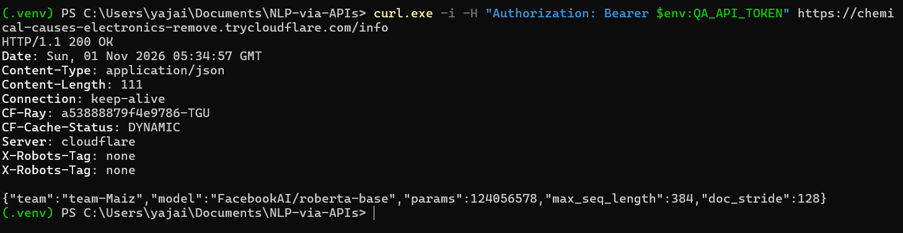
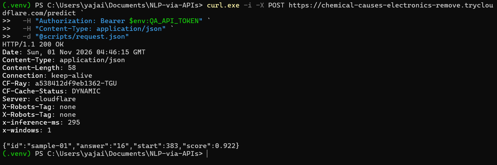

# Project Report — Extractive QA as a Service

## 0. Team

| Field | Value |
|---|---|
| Team id | `team-Maiz` |
| Members | Edwin Hernández, German Dueñas, Leandro Amaya, Yajaira Claros |
| Repository URL | https://github.com/YajairaClaros/NLP-via-APIs.git |
| `submission` commit hash | The commit tagged `submission` (`git rev-parse submission`). The hash is sent with the submission, because a commit cannot contain its own hash. |
| Public service URL used at the dry run | https://chemical-causes-electronics-remove.trycloudflare.com (Cloudflare Quick Tunnel; the URL changes each time the tunnel restarts) |
| AI tools used (which, and for what) | Claude (Anthropic). We used it to scaffold the training, evaluation and serving code, write the offline tests and the local harness, and debug our Windows setup (PowerShell execution policy, `.env`, tunnels). We reviewed every module and can explain it. No AI or commercial API is called at inference time: the model runs locally. |

## 1. Model choice and justification

- **Base checkpoint** (exact Hugging Face id): `FacebookAI/roberta-base`
- **Alternatives considered** (at least one) and why you did not choose them:
  - `distilbert/distilbert-base-uncased` (66M params). It is about twice as fast on CPU, but it is
    exactly the instructor's reference model (0.70). Matching the reference already gives full points,
    so a DistilBERT would leave us no margin for the hidden set. That set is written on texts that are
    not from SQuAD, and we expected some loss there.
  - `google-bert/bert-base-uncased` (110M params). It costs about the same on CPU as RoBERTa-base,
    but it does worse on SQuAD 2.0. RoBERTa was pre-trained on about 10× more text, with dynamic
    masking and without next-sentence prediction.
- **Trade-off:** RoBERTa-base has 124M parameters, roughly twice DistilBERT, so each request costs
  more CPU time. We checked that it still fits the limits on our laptop. In the dry run through the
  tunnel the mean round trip was **1.8 s** and the slowest item took **3.5 s**: `sample-05`, a
  3,200-character context read in several windows. That projects to about **89 s** for 50 items,
  against the 5 s per-request limit and the 150 s global cap. RoBERTa is also cased and uses
  byte-level BPE, so names, numbers and accents ("Cerén", "2,381", "50,257") never become unknown tokens.

## 2. Training

| Item | Value |
|---|---|
| Training data (full SQuAD 2.0 train or subset; how many examples) | Full SQuAD 2.0 train: 130,319 questions (about one third unanswerable), split into 131,823 windows of 384 tokens |
| Validation data (what you validated on, how many examples) | Loss curve: 2,000 SQuAD 2.0 dev questions. EM/F1 and threshold: full SQuAD 2.0 dev (11,873 questions), our own out-of-domain `eval/shadow_set.json` (33 questions, 8 unanswerable) and `public_sample.json` (5). |
| Epochs | 2 |
| Learning rate and schedule (warmup?) | 3e-5, AdamW (weight decay 0.01), 10 % linear warmup, then linear decay to 0 |
| Batch size | 16, no gradient accumulation (it fit in 6 GB with mixed precision) |
| `max_seq_length` / `doc_stride` | 384 / 128 |
| Hardware and training time | NVIDIA GeForce RTX 3050 Laptop GPU (6 GB), 134 minutes (2 h 14 min) for both epochs |

Every training example is split into windows of 384 tokens. Each window is labelled with the token
positions where the answer starts and ends. When the question has no answer, or the answer is not
fully inside that window, the label points to the first token (`<s>`, index 0). That is how the model
learns a "no answer" score. The loss is the mean of the start and end cross-entropies.

- **Loss curve:** `logs/roberta-base/loss.png` (every logged step is in `logs/roberta-base/train_log.jsonl`).
  The training loss starts at 5.98, which is what a random guess over a few hundred token positions
  gives: a sign that we really started from a base checkpoint. It ends at 0.65. The final validation
  loss is 0.87.
- **Validation results** at the selected threshold (`logs/roberta-base/eval_*.json`):

| Dataset | EM | F1 | HasAns F1 | NoAns acc. |
|---|---|---|---|---|
| SQuAD 2.0 dev (11,873) | 80.5 | 83.3 | 80.6 | 86.1 |
| Our shadow set, out-of-domain (33) | 90.9 | 93.0 | 90.8 | 100.0 |
| Public sample (5) | 100 | 100 | 100 | 100 |

On SQuAD dev we are well above the always-null baseline (50.1) and in the range usually reported for
RoBERTa-base. Our shadow set is written on texts that are not from SQuAD, and the model did even
better there: it abstained on all 8 unanswerable questions and missed only three answerable ones. On
`shadow-16` ("What does the name Adam stand for?") it returned the sentence that defines Adam instead
of "adaptive moment estimation". On `shadow-18` it gave a longer span than the reference, which counts
as a partial overlap. On `shadow-30` ("How many layers did the deepest ResNets have?") it abstained
although "152 layers" is in the text. It still abstains with threshold +6, so this is a model error,
not a threshold problem. The question uses "deepest ResNets", while the passage says "the authors
trained networks with 152 layers".

## 3. No-answer threshold

- **How the service decides to return `null`** (`qa/inference.py`):
  - The *null score* is `start_logit[<s>] + end_logit[<s>]`, taking the **minimum** over all windows
    of the context. Windows that do not contain the answer always vote "no answer", so we keep the
    window where the model is least sure about that.
  - The *span score* is the best `start_logit[i] + end_logit[j]` over context tokens with `i ≤ j` and
    at most 30 tokens, taking the **maximum** over all windows.
  - We return `null` when `null_score − span_score > threshold`.
- **How we chose it:** `train/evaluate.py` computes `null_score − span_score` once per question. It
  then tries several hundred thresholds and keeps the one that maximises the mean F1 over SQuAD 2.0
  dev, our shadow set and the public sample. We did not tune on SQuAD alone because about 50 % of its
  dev questions are unanswerable, while the hidden test has about 25 %. A threshold tuned only there
  would say "no answer" too often. **Final value: −2.049**, saved in `models/roberta-base/qa_meta.json`
  and shown in the service log at startup. Being negative means the model prefers to abstain unless
  the best span beats the no-answer option by a clear margin. The F1 curve and the % of null answers
  for each threshold are plotted in `logs/roberta-base/threshold.png`.
- **If it is too low or too high:**
  - Too low: the service answers `null` more often, and real answers become "wrong null" (0 points).
    In the limit we get the always-null baseline of 0.25.
  - Too high: it answers questions that have no answer, like the adversarial `sample-04` (BERT-base vs.
    GPT-3), which also scores 0.

  These are the numbers from our sweep (EM / F1, and the share of questions answered with `null`):

  | Threshold | SQuAD dev | Shadow set | Public sample |
  |---|---|---|---|
  | −6 (too low) | 77.9 / 80.1, 60.7 % null | 84.8 / 87.0, 36.4 % null | 80 / 80, 60 % null |
  | **−2.049 (selected)** | **80.5 / 83.3, 50.1 % null** | **90.9 / 93.0, 27.3 % null** | **100 / 100, 40 % null** |
  | 0 | 80.2 / 83.3, 45.8 % null | 87.9 / 90.0, 24.2 % null | 80 / 80, 20 % null |
  | +6 (too high) | 74.2 / 77.6, 33.9 % null | 84.8 / 87.0, 21.2 % null | 80 / 80, 20 % null |

  On SQuAD dev, 0 and −2.049 are almost tied. The difference shows on the out-of-domain sets.
  With threshold 0 the model answers one of the two unanswerable public questions and one of our
  trap questions; with −2.049 it abstains on both. That is worth +20 points on the public sample and
  +3 on the shadow set. Below −2.049 we start losing real answers (60 % nulls at −6 on SQuAD dev).
  Above 0 the model starts answering traps. Our shadow set has 24 % unanswerable questions, close to
  the hidden test's 25 %, and the 27 % of nulls it gets at the selected threshold are close to that,
  which is reassuring.

## 4. Serving architecture

- **Framework and server:** FastAPI + uvicorn with **1 worker**. A second worker would load a second
  copy of the model and fight for the same CPU cores.
- **Model loading:** when the app starts, a background thread loads the model, the tokenizer and
  `qa_meta.json` (threshold, window size) from `QA_MODEL_DIR`. It then runs one warm-up prediction.
  Until that finishes, `/health` answers `503 {"status": "loading"}`, and after that
  `200 {"status": "ok"}`. On our laptop this takes 6–12 s.
- **Request flow** (`POST /predict`):
  1. The auth middleware checks the bearer token. Nothing else runs if it fails.
  2. Pydantic validates the body: the three fields are required, no extra fields are allowed, types
     are strict and the contract's length limits apply. An invalid body gets
     `400 {"error": "bad_request", "detail": ...}`.
  3. The question is clipped to 128 tokens. The question and context are tokenized into windows of
     384 tokens with a 128-token overlap, so a 5,000-character context (about 5 windows) is read
     completely.
  4. All windows go through the model in one batch on CPU. A lock ensures only one inference runs at a time.
  5. The best span and the null score are compared across windows, and the threshold decides.
  6. The answer is cut from the **original** context using the tokenizer's character offsets, so
     `context[start:start+len(answer)] == answer` holds by construction. It is checked again before
     responding.
  7. `score` is the softmax probability of the returned output (the span, or no-answer) among all
     candidates. The response also carries `X-Inference-Ms` and `X-Windows` headers, which we use for
     latency measurements.
- **Access control:** an HTTP middleware in `app/main.py` runs before routing and body parsing, for
  `/info` and `/predict`.
  - It requires exactly `Authorization: Bearer <token>`, case-sensitive, and compares the token in
    constant time (`hmac.compare_digest`).
  - Any failure returns `401 {"error": "unauthorized"}` with `WWW-Authenticate: Bearer`.
  - The token is read only from the environment variable `QA_API_TOKEN`, or from an untracked `.env`
    file, and the service refuses to start without it.
  - `/docs` and `/openapi.json` are disabled.
  - The server binds to `127.0.0.1`, so from outside it is reachable only through the tunnel.
  - A git pre-commit hook (`scripts/githooks/pre-commit`) blocks any commit that contains the token
    value, `.env` or model weights.
  - The public `/demo` page we use in the pitch is static HTML. It asks for the token and then calls
    the same protected endpoints.
- **Tunnel:** Cloudflare Quick Tunnel, with `cloudflared tunnel --url http://localhost:8000`. We first
  tried ngrok and had to drop it (Section 7).
- **How to run** from a clean machine (commands and environment variables):

```powershell
git clone https://github.com/YajairaClaros/NLP-via-APIs.git
cd NLP-via-APIs
python -m venv .venv
.venv\Scripts\Activate.ps1
pip install -r requirements.txt
# the fine-tuned model (496 MB, not in git) must be in models\roberta-base\ ; to rebuild it: python -m train.train --epochs 2 --lr 3e-5 --batch_size 16
copy .env.example .env      # then set QA_API_TOKEN, QA_TEAM=team-Maiz, QA_MODEL_DIR=models/roberta-base
.\scripts\serve.ps1         # = python -m uvicorn app.main:app --host 127.0.0.1 --port 8000 --workers 1
# in a second terminal:
cloudflared tunnel --url http://localhost:8000
```

## 5. Results on the public sample set

Dry run through the tunnel with `python -m eval.harness --url <public-url>` (screenshots in
`docs/dry_run/`, raw results in `eval/results/`):

| Item | Expected | Your answer | `start` | Correct? |
|---|---|---|---|---|
| sample-01 | `16` / `16 attention heads` | `16` | 383 | Yes (exact match) |
| sample-02 | `3.5 days` | `3.5 days` | 437 | Yes (exact match) |
| sample-03 | `null` | `null` | `null` | Yes (correct null) |
| sample-04 | `null` | `null` | `null` | Yes (correct null) |
| sample-05 | `50,257` / `50,257 tokens` | `50,257` | 3157 | Yes (exact match) |

All five are correct, and all the contract and access-control checks passed. Two items were the ones
we worried about most:

- `sample-04` is a trap: it asks about BERT-base while the passage only talks about GPT-3. The model
  abstained, which is what the threshold is for.
- `sample-05` has its answer in the last sentence of a context longer than 512 tokens. The model found
  it in a later window, which confirms the sliding window works.

It was also the slowest request (3.5 s), because that context needs several windows.

### Dry run evidence (through the public tunnel)

1. `GET /health`, no token → 200
   
2. `GET /info`, no token → 401
   
3. `GET /info`, wrong token → 401
   
4. `GET /info`, valid token → 200
   
5. Harness: access control, request validation and the public sample
   

## 6. Model size and latency (not graded)

| Item | Value |
|---|---|
| Parameters | 124,056,578 (reported by `/info`) |
| Size on disk | 496 MB (`model.safetensors`, float32) |
| Mean latency per `/predict` request on your laptop (CPU) | Model only, on the laptop: 0.38 s mean (8 challenge questions), 0.88 s for a 3,050-character passage (3 windows). Through the Cloudflare tunnel: 1.8 s mean, 3.5 s max (public sample, 5 requests), so a large part of the round trip is network. |
| Laptop CPU and RAM | 13th Gen Intel Core i5-13420H (12 logical cores), 16 GB RAM; PyTorch uses 8 threads |

## 7. Problems encountered and how you fixed them

1. **Problem:** during our contract tests, a valid request with a long question (the contract allows
   500 characters) crashed `/predict` with a 500 error.
   **Cause:** we tokenize with `truncation="only_second"`, which can only shorten the context. A
   question that does not fit in the window by itself makes the tokenizer raise an error.
   **Fix:** `QAModel._clip_question` cuts the question to `min(128, max_seq_length // 2)` tokens,
   using character offsets, before building the windows. It is covered by
   `tests/test_api.py::test_limits_accepted`.
   **Commit:** `d7a5137`
2. **Problem:** we could not open a public tunnel with ngrok, the tool we had planned to use.
   **Cause:**
   - `winget` installed ngrok 3.3.1, and the ngrok service rejected it: our free account requires
     agent 3.28 or newer (`ERR_NGROK_121`).
   - When we downloaded the current version by hand, Windows Defender blocked the file as
     "potentially unwanted software", so it could not even be extracted.
   **Fix:** we switched to Cloudflare Quick Tunnel, the second tool allowed by the brief. It needs no
   account, and it worked the first time. The trade-off is that its URL changes on every restart. We
   therefore took all the dry-run evidence in a single session, and we keep that window open during
   the evaluation.
   **Commit:** "Switch tunnel to Cloudflare Quick Tunnel, rewrite README, add report helper" (`git log --oneline --grep=Cloudflare`)
3. **Problem:** `/info` kept answering `"team": "team-XX"` after we had written our team id in the report.
   **Cause:** the service reads the team id from the `QA_TEAM` environment variable (our `.env`) once,
   at startup. Editing `REPORT.md` changes nothing at runtime.
   **Fix:** we set `QA_TEAM=team-Maiz` in `.env`, without the accent to keep the file ASCII, and
   restarted the service. This was a configuration change only; `.env` is git-ignored on purpose,
   so there is no commit.

## 8. Decoder investigation

Our encoder can only do one thing: point to one contiguous piece of the passage, or say "no answer".
To see where that breaks, we wrote `eval/challenge_set.json`, with 8 questions whose correct answer is
*not* a span of the text. We ran our model on them locally (`scripts/report_numbers.py`):

| Type | Question | What our model returned (score) | Correct answer |
|---|---|---|---|
| Yes/no | Is 403 Forbidden a server error? | "the server understood who the client is but refuses to authorize the action" (0.25) | No |
| Yes/no | Does a container include a full guest operating system? | "it does not" (0.29) | No |
| Non-contiguous | What two quantities does Adam keep moving averages of? | "first moment, and of the squared gradient, called the second moment" (0.18) | the gradient and the squared gradient |
| Non-contiguous | Which three volcanoes form Los Volcanes National Park? | "Izalco and Cerro Verde volcanoes" (0.51) | Santa Ana, Izalco and Cerro Verde |
| Arithmetic | How many years passed between the discovery of Joya de Cerén and its addition to the UNESCO list? | "1993" (0.98) | 17 |
| Arithmetic | How many years after AlexNet won ILSVRC did a ResNet ensemble win it? | `null` (0.80); best span "2015" | 3 |
| Arithmetic | By how many percentage points did AlexNet beat the second-best entry? | "26.2%" (0.94) | 10.9 |
| Free-form | Why does dropout help a network generalize? | `null` (0.12); best span "prevents units from co-adapting too much and forces the network to learn more robust features" | It prevents co-adaptation, forcing more robust features |

What we learned, and how a decoder (GPT-style) or an encoder–decoder (T5-style) would handle each case:

- **Yes/no questions.** The word "No" is not in either passage, so the best our model can do is copy a
  nearby phrase.
  - For the container question it got lucky: "it does not" works as an answer, and a person would
    accept it.
  - For the 403 question it copied the sentence that defines 403, which is related but answers nothing.
  - A generative model simply writes "No". *Cost:* free text breaks exact-match grading unless the
    output is constrained to "Yes"/"No". A cheaper option is to keep the encoder and add a small yes/no
    classification head next to the span head.
- **Answers split across the passage.** For the volcanoes it returned "Izalco and Cerro Verde
  volcanoes" and lost "Santa Ana", which is in the first sentence, far away. For Adam it returned a
  broken span that starts in the middle of one clause and ends in another. One span cannot join two
  separate pieces of text. A decoder can write "Santa Ana, Izalco and Cerro Verde" in one go.
- **Arithmetic.** This is the most worrying case, because the model is confidently wrong.
  - It answered "1993" with a score of 0.98 when the question asked for 1993 − 1976 = 17.
  - It answered "26.2%" with 0.94 instead of 15.3 vs. 26.2 = 10.9 points.
  - It can only point at numbers that are written in the text, and its score measures "this is the
    right place in the text", not "this is the right answer".
  - A decoder can do the subtraction, although small decoders also make arithmetic mistakes, so the
    gain is not guaranteed.
- **Why/how questions.** For dropout it found a good explanation ("prevents units from co-adapting
  too much…"), but with a low score, so the threshold made it abstain. Long, explanatory answers are
  rare in SQuAD, which is mostly short facts. A decoder trained on instructions handles them naturally.
- **Long contexts.** We cut a 5,000-character context into about 5 windows of 384 tokens and score
  each one separately, so no window ever sees the whole passage. This worked for `sample-05`, but it
  would fail if the answer needed two facts that sit in different windows. A decoder with a long
  context window reads everything at once, at a much higher compute cost.
- **What it would cost us.**
  - Our encoder answers in about 0.4 s on the laptop's CPU (0.9 s for a 3,000-character passage).
  - A decoder generates the answer one token at a time and needs a longer prompt. Even a small
    instruction-tuned model would likely take several seconds per answer on the same CPU, which is
    risky against the 5 s limit.
  - It would also need more memory and disk.
  - It can invent text that is not in the passage, which for this task is worse than abstaining.
  - Fine-tuning one within 1.5 weeks would only be realistic with LoRA (Hu et al., 2021).

  For a fixed contract graded by exact match with a 5 s limit, the encoder was the right tool. A
  decoder, or a yes/no head, would be the next step for the question types above.

## 9. Known limitations

- **English only.** A question or passage in Spanish still gets a span or `null`, but we did not
  measure its quality.
- **Answers longer than 30 tokens** cannot be returned whole (`max_answer_tokens`).
- **Yes/no, multi-part, arithmetic and summary questions** cannot be answered correctly. The service
  returns a span or `null` (Section 8).
- **Contexts over 5,000 characters** are rejected with 400, as the contract requires. Questions over
  128 tokens are clipped.
- **Latency grows with context length, and the tunnel adds to it.** On the laptop alone a
  3,000-character passage takes about 0.9 s. Through the tunnel our slowest dry-run request took
  3.5 s, so most of that time is network. A 5,000-character context on a slow connection could get
  close to the 5 s limit. During the evaluation we keep the laptop plugged in, in high-performance
  mode, with other programs closed and on a stable connection.
- **One request at a time.** Requests queue behind a lock. That is fine for the sequential harness,
  but it would add latency if many users called at once.
- **The tunnel URL is temporary.** A Cloudflare Quick Tunnel gets a new URL on every restart, so we
  must send the current one to the instructor before our slot.
- **The threshold was tuned on SQuAD plus 38 hand-written or public items.** It may not be optimal for
  the instructor's texts.
- **`score` is not calibrated.** It is a softmax over the candidates and should not be read as the
  probability that the answer is correct.
